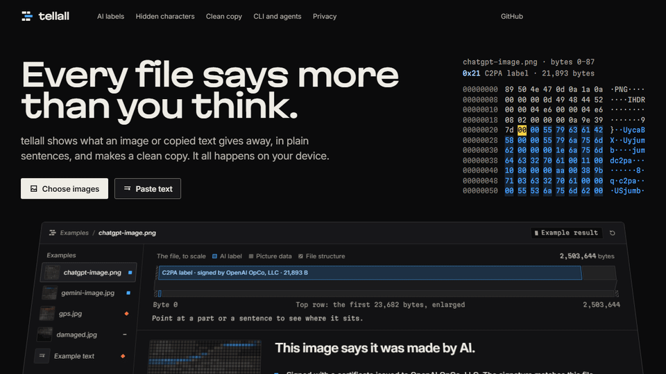
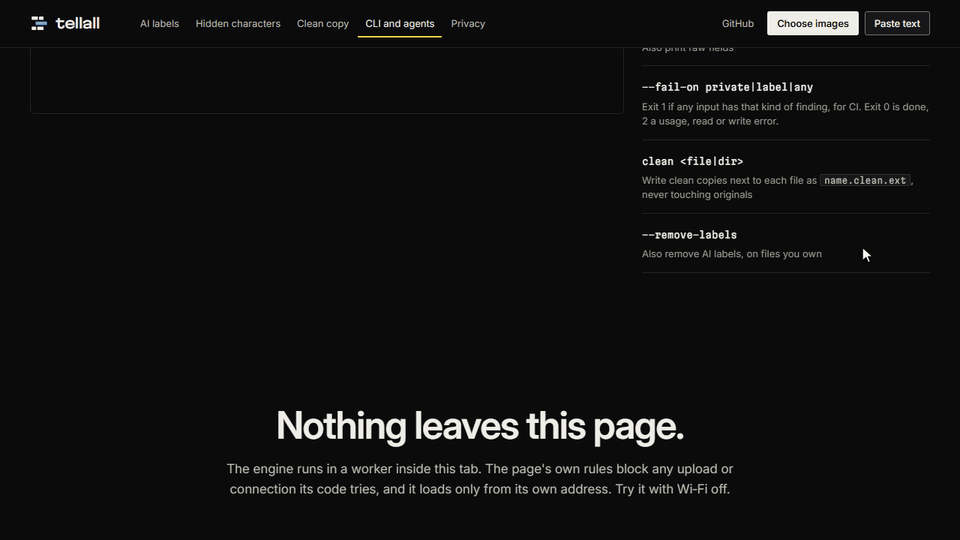

# tellall

See in plain sentences what an image or a copied text tells about you, then get a clean copy.



Your ChatGPT image is a tell-all: who made it, the exact time, and an admission that it's watermarked. tellall reads all of it out, and everything runs on your own device.

## Use it

- Web page: [tellall.candygoogy.dev](https://tellall.candygoogy.dev). Drop images on it or paste text.
- Command line: `npx tellall photo.jpg`, with Node 20.19 or later. Every option is in the [CLI reference](packages/cli/README.md).
- Agent skill: `/plugin install tellall --marketplace candygoogy/tellall` in Claude Code. For Codex and Cursor, see [Agent skill](#agent-skill).

## A ChatGPT image, as it came

Downloaded from ChatGPT on 25 October 2026 and not touched since:

```
$ npx tellall chatgpt-image.png
chatgpt-image.png
  This image says it was made by AI.
  · Signed with a certificate issued to OpenAI OpCo, LLC. The signature matches this file.
  · Made with ChatGPT (gpt-image) on 25 Oct 2026 at 14:46:19 UTC.
  · The label says OpenAI also put an invisible watermark in the pixels. A clean copy can't remove it.
  · No location, camera or other personal data.
```

An image from Gemini gets the same headline, with a label signed by Google LLC that also names its watermark, SynthID. tellall doesn't guess whether an image is AI. It reads the labels the file carries and tells you what they say.

## What it finds

| In an image (JPEG, PNG, WebP, HEIC)                                    | In a text (pasted or piped in)                                                       |
| ---------------------------------------------------------------------- | ------------------------------------------------------------------------------------ |
| AI labels (C2PA): signer, tool, time, watermark claim, signature check | Zero-width, tag and variation-selector characters, decoded when they spell something |
| AI-source tag (IPTC DigitalSourceType)                                 | Direction controls and other invisible formatting                                    |
| Location, camera, lens, serial numbers, dates, software                | In a formatted copy: response IDs, class names, styles, hidden parts                 |
| Tracking IDs that link copies of the same file                         | A note on the page address your browser may add to a copy                            |
| Names, captions, comments                                              |                                                                                      |
| Details it can't name                                                  |                                                                                      |

Usually harmless characters, such as emoji joiners, are listed but don't count.

## Clean copies

A test photo from this repo's fixtures, with made-up data planted in it:

```
$ npx tellall gps.jpg
gps.jpg
  This file gives away 5 kinds of personal data.
  · It records the exact place it was taken: 51.4769° N, 0.0005° W.
  · It names the camera: Example Cam 1. It names the lens: Example 35mm.
  · It records when it was taken: 1 Oct 2026 at 12:00:00.
  · It names the software that saved it: Example Editor 2.
  · It names a person: Test Person. It carries a comment: Made for a test.
```

`npx tellall clean` writes a copy next to each file, as `name.clean.ext`, and leaves the original alone. When there's nothing to remove, it writes no copy and says so; `--always` writes one anyway.

```
$ npx tellall clean chatgpt-image.png gps.jpg
chatgpt-image.png
  No copy written.
  · Nothing private to remove.

gps.jpg
  Wrote gps.clean.jpg
  Removed location, camera and device details, dates and times, software names and other details: 951 bytes.
```

On the page, _Download clean copy_ saves one image, _Download all clean_ saves several as a zip, and _Copy clean text_ copies text without its hidden characters and formatted-copy extras.

|                                                                       | `clean` and the web page             | `clean --remove-labels` |
| --------------------------------------------------------------------- | ------------------------------------ | ----------------------- |
| GPS, camera, serial numbers, dates, software, comments                | removed                              | removed                 |
| Other XMP and Exif (not the orientation), metadata tellall can't name | removed                              | removed                 |
| Tracking IDs (DocumentID, InstanceID, GUIDs)                          | removed                              | removed                 |
| Colour profile, HDR gain map (Ultra HDR)                              | kept, the picture needs them         | kept                    |
| AI label (C2PA) and AI-source tag                                     | kept, with any data inside the label | removed                 |
| Pixels                                                                | untouched, byte for byte             | untouched               |

When a labelled image also has private data, the copy keeps the label, which then no longer matches the file, and tellall says so. The page never removes AI labels. On files you own, `npx tellall clean --remove-labels` does, and it reminds you that any invisible watermark in the pixels stays.

## Agent skill

In Claude Code, install the skill with `/plugin install tellall --marketplace candygoogy/tellall`, then ask things like "what does this image give away?" or "clean these photos before I publish them". The skill runs `npx -y tellall` and explains the result in the same plain words. It removes AI labels only when you ask for that and the files are yours.

For Codex and Cursor, copy the folder [`plugin/tellall/skills/tellall`](plugin/tellall/skills/tellall) into `~/.agents/skills/`, or into a project's `.agents/skills/`. Both read skills from there.

## Privacy

Files never leave your device. The page reads them in a Web Worker in your browser. Its Content Security Policy sets `connect-src 'none'`, so the browser blocks any upload or connection the page's code tries, and the page loads only from its own address, with no third-party scripts, fonts or images. Load it once, turn Wi-Fi off, and it still reads your files. The command-line tool reads and writes files on your machine and makes no network requests; only `npx` itself downloads the package.



## Limits

- tellall can't see or remove watermarks hidden in the pixels, such as Google's SynthID, or statistical watermarks in text; it reports only what an AI label says about one, and a clean copy keeps it. The page links the makers' own checkers, Google's [SynthID Detector](https://synthid.com/) (needs sign-in) and [OpenAI's checker](https://openai.com/verify), as plain links: tellall sends nothing.
- No marks found doesn't mean a person made the file. Many apps and sites strip labels and metadata when you upload.
- It checks that a label's signature matches the file. It doesn't check who stands behind the certificate.
- WebP labels can be found but not read yet, and GIF, AVIF, TIFF, SVG, PDF, Office files, audio and video aren't supported yet.
- English only.

## Development

npm workspaces: `packages/engine` (reading, cleaning and sentences), `packages/cli` and `web`. Development needs Node 22.12 or later; the command-line tool itself needs 20.19. Run `npm install`, then `npx vitest run`. The `$ npx tellall` examples in this README are real output: `packages/engine/test/readme-claims.test.ts` checks them against the fixtures in `fixtures/`.

## License

MIT. Copyright (c) 2026 candygoogy. Image reading and cleaning come from [Photo check](https://photo.candygoogy.dev), by the same author.
